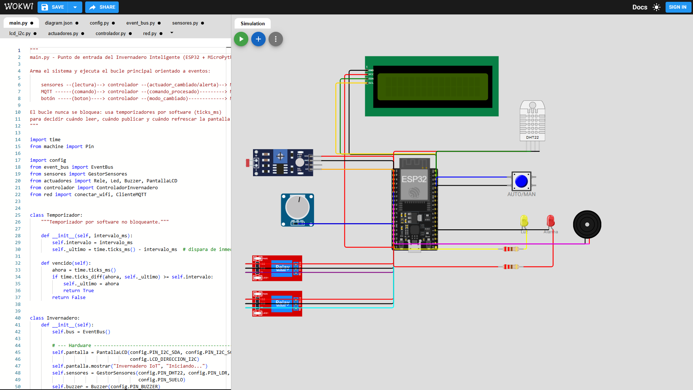
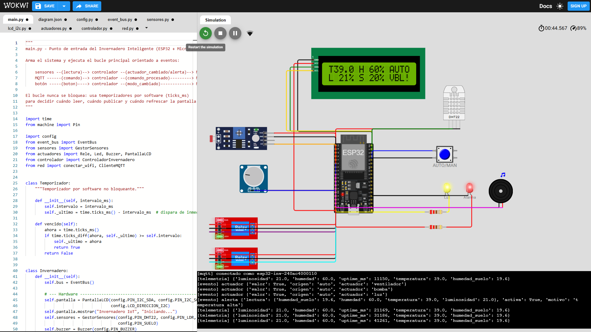
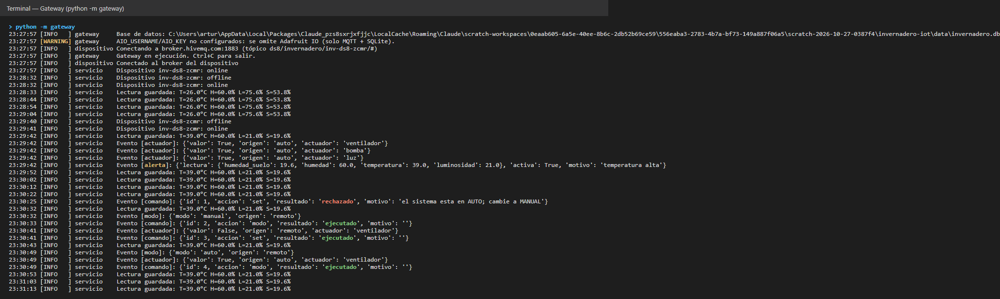
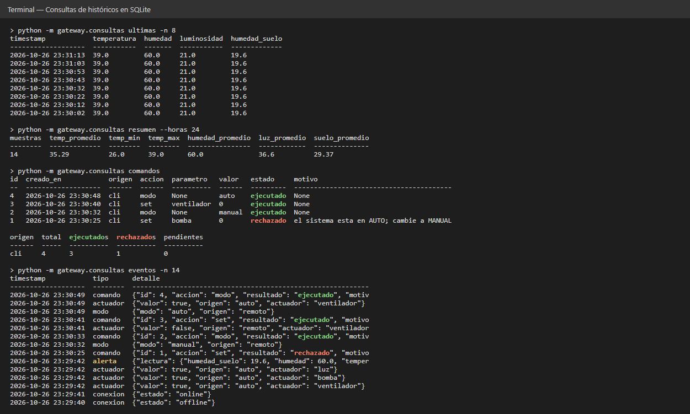

# 🌱 Invernadero Inteligente IoT

**Desarrollo de Software VIII — Parcial #2: Sistema IoT de Monitoreo y Control Inteligente**

Un ESP32 simulado en **Wokwi** ([abrir simulación](https://wokwi.com/projects/479012574867451905)) con MicroPython mide las condiciones de un invernadero y controla ventilación, riego e iluminación de forma automática. Los datos viajan por **MQTT (HiveMQ)** hasta un **gateway en Python**, que los guarda en **SQLite** y los publica en **Adafruit IO**. Desde el dashboard de Adafruit IO se ven los datos en tiempo real y se envían comandos de vuelta al dispositivo.

## Integrantes y aportes

| Integrante | Aporte | Archivos a su cargo |
|---|---|---|
| **Estefanny Zambrano** | Base de datos y consultas de históricos: diseño del esquema SQL, almacenamiento de lecturas, eventos y comandos, y la CLI de consultas | `sql/schema.sql`, `sql/consultas.sql`, `gateway/database.py`, `gateway/consultas.py` |
| **Alberto Chen** | Arquitectura, diagramas y circuito: diagrama de arquitectura y de flujo de datos, circuito en Wokwi y programación orientada a eventos (bus de eventos y bucle principal) | `docs/arquitectura.md`, `dispositivo/diagram.json`, `dispositivo/event_bus.py`, `dispositivo/main.py` |
| **Edwin Moreno** | Sensores, actuadores y lógica de control: lectura de sensores por GPIO/ADC, manejo de relés, LEDs, buzzer y LCD, y reglas automáticas con histéresis y alarmas | `dispositivo/sensores.py`, `dispositivo/actuadores.py`, `dispositivo/lcd_i2c.py`, `dispositivo/controlador.py`, `dispositivo/config.py` |
| **Arturo Rodríguez** | Comunicación MQTT y plataforma en la nube: cliente MQTT del ESP32, gateway, integración con Adafruit IO (dashboard y comandos remotos) | `dispositivo/red.py`, `gateway/enlace_dispositivo.py`, `gateway/enlace_adafruit.py`, `gateway/servicio.py`, `docs/configuracion_adafruit_io.md`, `herramientas/` |

---

## Capturas

| Circuito en Wokwi | Alarma: ventilador, bomba, luz y buzzer activos |
|---|---|
|  |  |

| Gateway recibiendo datos y comandos | Consultas de históricos en SQLite |
|---|---|
|  |  |

Todas las capturas, con su descripción, están en [`docs/capturas/`](docs/capturas/README.md).

---

## Componentes

| Tipo | Componente (Wokwi) | GPIO | Función |
|---|---|---|---|
| Sensor | DHT22 | 15 | Temperatura (°C) y humedad del aire (%) |
| Sensor | Fotorresistor LDR (AO) | 34 | Luminosidad (%) |
| Sensor | Potenciómetro | 35 | Simula sensor de humedad de suelo (%) |
| Entrada | Pulsador | 4 | Alterna modo AUTO / MANUAL (interrupción) |
| Actuador | Relé 1 | 26 | Ventilador |
| Actuador | Relé 2 | 27 | Bomba de riego |
| Actuador | LED amarillo | 14 | Luz de crecimiento |
| Actuador | LED rojo | 13 | Indicador de alarma |
| Actuador | Buzzer (PWM) | 25 | Alarma sonora intermitente |
| Actuador | LCD 16x2 I2C | 21 (SDA) / 22 (SCL) | Lecturas y estado local |

## Lógica de control (modo AUTO)

| Regla | Enciende cuando | Apaga cuando |
|---|---|---|
| Ventilador | temperatura ≥ `temp_max` (30 °C) | temperatura ≤ 28.5 °C |
| Bomba de riego | humedad de suelo ≤ `suelo_min` (30 %) | humedad de suelo ≥ 45 % |
| Luz de crecimiento | luminosidad ≤ `luz_min` (30 %) | luminosidad ≥ 40 % |
| **Alarma** (siempre activa) | T ≥ 38 °C, T ≤ 10 °C o suelo ≤ 10 % | condición normalizada |

La **histéresis** (la diferencia entre el umbral de encendido y el de apagado) evita que un relé conmute una y otra vez cuando la lectura oscila cerca del umbral. En **modo MANUAL** las reglas se desactivan y solo los comandos remotos mueven los actuadores. La alarma funciona en ambos modos.

---

## Estructura del proyecto

```
invernadero-iot/
├── dispositivo/              # Firmware MicroPython (se copia a Wokwi)
│   ├── main.py               # Arranque y bucle principal orientado a eventos
│   ├── config.py             # Pines, red, MQTT, umbrales
│   ├── event_bus.py          # Bus de eventos publicador/suscriptor
│   ├── sensores.py           # DHT22, LDR, humedad de suelo
│   ├── actuadores.py         # Relés, LEDs, buzzer, LCD
│   ├── lcd_i2c.py            # Driver HD44780 + PCF8574
│   ├── controlador.py        # Reglas AUTO/MANUAL, histéresis, alarmas, comandos
│   ├── red.py                # WiFi + cliente MQTT con reconexión y LWT
│   └── diagram.json          # Circuito de Wokwi
├── gateway/                  # Servicio Python en la PC
│   ├── __main__.py           # python -m gateway
│   ├── config.py             # Lee .env
│   ├── database.py           # Repositorio SQLite (inserciones y consultas)
│   ├── enlace_dispositivo.py # Cliente MQTT hacia HiveMQ
│   ├── enlace_adafruit.py    # Cliente MQTT/TLS hacia Adafruit IO
│   ├── servicio.py           # Orquestador: dispositivo <-> BD <-> nube
│   └── consultas.py          # CLI de históricos y envío de comandos
├── sql/
│   ├── schema.sql            # Tablas: dispositivos, lecturas, eventos, comandos
│   └── consultas.sql         # Consultas de históricos
├── herramientas/
│   ├── simulador_dispositivo.py  # Simula el ESP32 en la PC (pruebas sin Wokwi)
│   └── configurar_adafruit.py    # Crea feeds y dashboard en Adafruit IO por API
├── docs/
│   ├── arquitectura.md       # Arquitectura, flujo de datos, tópicos MQTT
│   ├── configuracion_adafruit_io.md
│   ├── guia_sustentacion.md
│   └── capturas/             # Capturas del circuito y del dashboard
├── wokwi/                    # Colocar aquí el .zip descargado de Wokwi
├── requirements.txt
└── .env.example
```

---

## Puesta en marcha

### 1. Dispositivo en Wokwi

1. Inicie sesión en <https://wokwi.com> y abra <https://wokwi.com/projects/new/micropython-esp32> (ESP32 DevKit-C v4 + MicroPython).
2. Pestaña `diagram.json`: borre todo y pegue el contenido de [`dispositivo/diagram.json`](dispositivo/diagram.json). El circuito aparece a la derecha.
3. Pestaña `main.py`: borre todo y pegue [`dispositivo/main.py`](dispositivo/main.py).
4. Para cada uno de `config.py`, `event_bus.py`, `sensores.py`, `lcd_i2c.py`, `actuadores.py`, `controlador.py` y `red.py`: flecha ▾ junto a las pestañas → **New file...** → escriba el nombre exacto → **Create** → pegue el contenido.
5. **Save** y póngale un nombre ("Invernadero IoT DS8"). Copie el enlace del proyecto en [`wokwi/README.md`](wokwi/README.md).
6. Presione ▶. En el monitor serie debe aparecer `[wifi] conectado` y `[mqtt] conectado`, y el LCD muestra las lecturas.
7. Para probar durante la simulación, haga clic en un componente:
   - DHT22 con temperatura > 30 °C → enciende el ventilador;
   - potenciómetro hacia la izquierda → enciende la bomba;
   - LDR con poca luz → enciende el LED amarillo;
   - temperatura ≥ 38 °C → alarma.
8. Flecha ▾ junto a **Save** → **Download project zip** → guarde el `.zip` en `wokwi/`.

`DISPOSITIVO_ID` ya está configurado como `inv-ds8-zcmr` (iniciales del grupo) en `config.py` y en `.env.example`, y deben coincidir.

### 2. Gateway (PC)

```bash
python -m venv .venv
.venv\Scripts\activate          # Windows  (Linux/Mac: source .venv/bin/activate)
pip install -r requirements.txt
copy .env.example .env          # Linux/Mac: cp .env.example .env
```

Edite `.env`: use el **mismo** `DISPOSITIVO_ID` que en Wokwi y agregue `AIO_USERNAME` y `AIO_KEY` (ver [configuración de Adafruit IO](docs/configuracion_adafruit_io.md)). Luego cree los feeds y el dashboard (una sola vez) e inicie el gateway:

```bash
python herramientas/configurar_adafruit.py
python -m gateway
```

La base `data/invernadero.db` se crea sola a partir de `sql/schema.sql`.

> **¿Sin Wokwi a mano?** `python herramientas/simulador_dispositivo.py` simula el ESP32 con el mismo controlador.

### 3. Consultas de históricos y comandos

```bash
python -m gateway.consultas ultimas -n 10
python -m gateway.consultas resumen --horas 24
python -m gateway.consultas por-hora
python -m gateway.consultas rango "2026-10-26 08:00:00" "2026-10-26 18:00:00"
python -m gateway.consultas eventos --tipo alerta
python -m gateway.consultas comandos
python -m gateway.consultas exportar lecturas.csv

python -m gateway.consultas enviar modo manual
python -m gateway.consultas enviar set ventilador 1
python -m gateway.consultas enviar umbral temp_max 28
```

---

## Protocolo MQTT

Tópico base: `ds8/invernadero/<DISPOSITIVO_ID>`

| Sub-tópico | Dirección | Ejemplo de mensaje |
|---|---|---|
| `/telemetria` | ESP32 → gateway | `{"temperatura": 31.2, "humedad": 58, "luminosidad": 44.1, "humedad_suelo": 52.3, "uptime_ms": 120345}` |
| `/estado` (retenido) | ESP32 → gateway | `{"modo": "auto", "ventilador": true, "bomba": false, "luz": false, "alarma": false, "umbrales": {...}}` |
| `/eventos` | ESP32 → gateway | `{"tipo": "actuador", "detalle": {"actuador": "ventilador", "valor": true, "origen": "auto"}}` |
| `/conexion` (retenido, LWT) | ESP32 → gateway | `online` / `offline` |
| `/comandos` | gateway → ESP32 | `{"id": 7, "accion": "set", "actuador": "bomba", "valor": 1}` |

Comandos aceptados: `set` (ventilador/bomba/luz, solo en MANUAL), `modo` (auto/manual), `umbral` (cualquier clave de `UMBRALES`) y `estado`. Cada comando recibe un *ack* (evento `comando` con `resultado: ejecutado | rechazado`), y con ese ack el gateway actualiza la tabla `comandos`.

Más detalle en [docs/arquitectura.md](docs/arquitectura.md).
