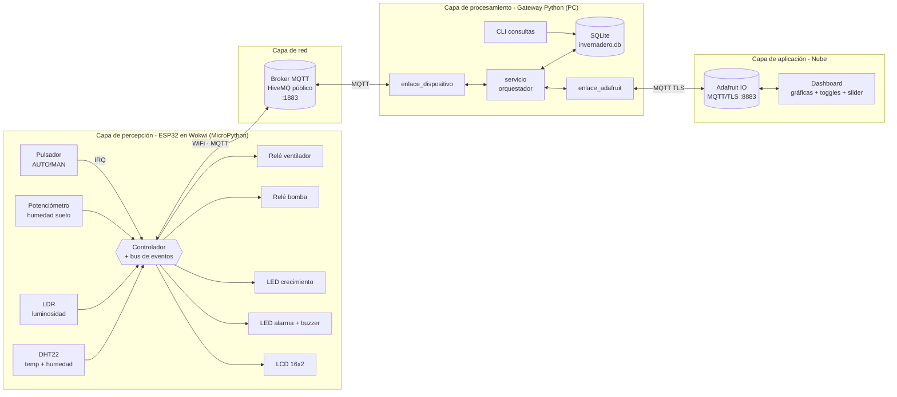
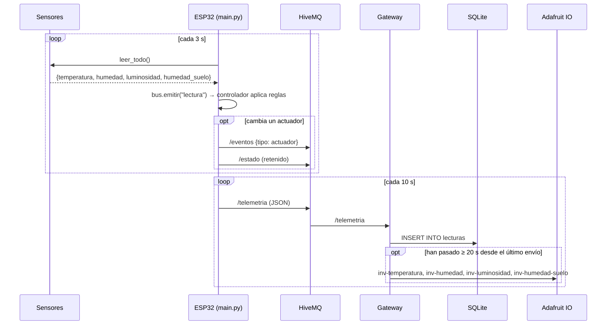
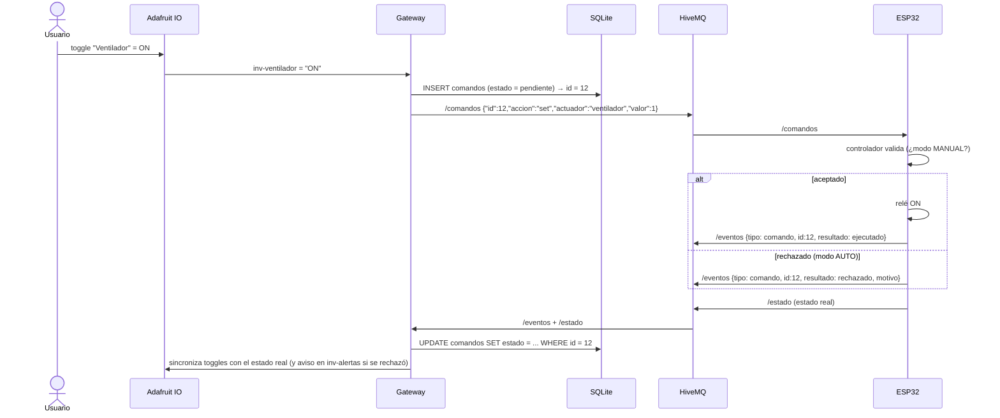
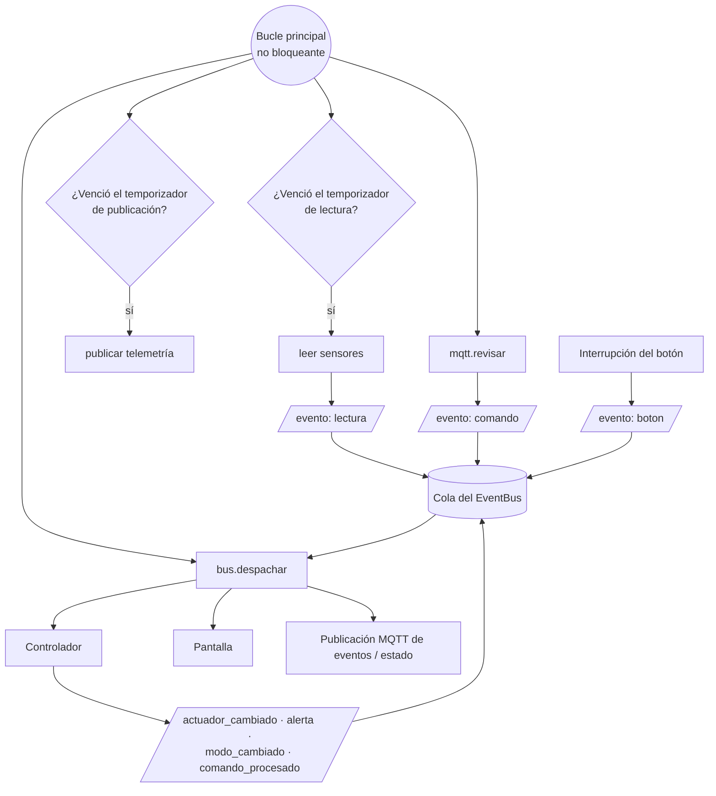
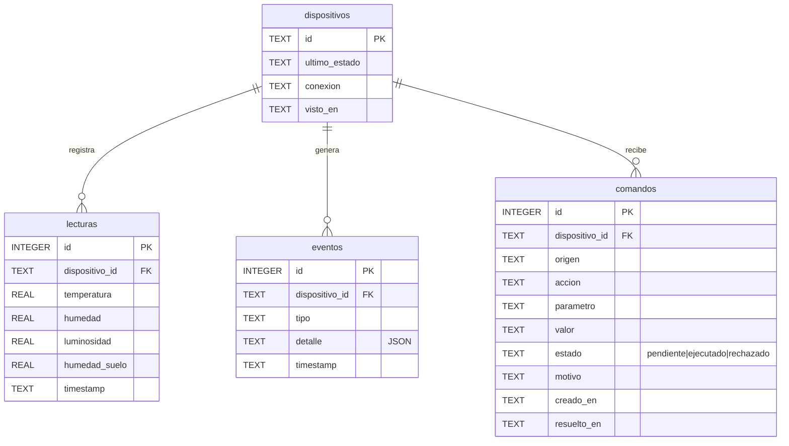

# Arquitectura IoT — Invernadero Inteligente

## 1. Vista general (capas)

El sistema sigue la arquitectura IoT clásica de capas: **percepción → red → procesamiento/almacenamiento → aplicación**.

**¿Por qué un gateway?** El ESP32 habla con un broker MQTT liviano (HiveMQ), como pide el enunciado. El gateway agrega lo que un microcontrolador no hace bien:

- persistir datos en SQL,
- guardar las credenciales de la nube fuera del dispositivo,
- respetar el límite de tasa de Adafruit IO (30 datos/min en el plan gratuito),
- llevar la trazabilidad de cada comando.

Es el patrón **edge/fog gateway**.

## 2. Flujo de datos

### 2.1 Telemetría (dispositivo → nube)

### 2.2 Comando remoto (nube → dispositivo)

### 2.3 Programación orientada a eventos en el ESP32

Los módulos no se llaman entre sí. Se comunican por eventos a través de `EventBus`, y eso permite agregar un consumidor (por ejemplo, un nuevo actuador) sin tocar a los productores.

## 3. Modelo de datos

El *timestamp* lo pone el gateway al recibir el mensaje, porque el ESP32 no tiene reloj de tiempo real. El ESP32 envía además `uptime_ms` como referencia.

## 4. Tópicos MQTT y QoS

| Tópico | QoS | Retenido | Motivo |
|---|---|---|---|
| `…/telemetria` | 0 | no | Lecturas frecuentes; si se pierde una, llega otra en 10 s |
| `…/eventos` | 0 | no | Notificaciones |
| `…/estado` | 0 | **sí** | Quien se conecte recibe de inmediato el último estado |
| `…/conexion` | 1 | **sí** | *Last Will*: el broker publica `offline` si el ESP32 cae |
| `…/comandos` | 1 | no | Una orden debe llegar al menos una vez |

## 5. Decisiones de diseño

| Decisión | Alternativa | Razón |
|---|---|---|
| Gateway en PC entre HiveMQ y Adafruit IO | ESP32 directo a Adafruit IO | El enunciado pide un broker HiveMQ/Mosquitto/EMQX en el dispositivo. Además, SQLite no corre en el ESP32 y así las credenciales de la nube no quedan en el firmware |
| SQLite | MySQL/PostgreSQL | Sin servidor que instalar. Un solo archivo fácil de entregar y revisar |
| Control on/off con histéresis | Umbral simple | Evita el *chattering* (conmutación rápida) que desgasta los relés |
| Rechazar `set` en modo AUTO | Aceptarlo siempre | Si no, la regla automática deshace la orden manual en la siguiente lectura y el usuario no entiende qué pasó |
| Ack con `id` de comando | *Fire and forget* | Trazabilidad: la tabla `comandos` sabe qué se ejecutó y qué se rechazó |
| Bus de eventos + temporizadores por software | `sleep()` en el bucle | El bucle nunca se bloquea: atiende botón, red y sensores "a la vez" |
